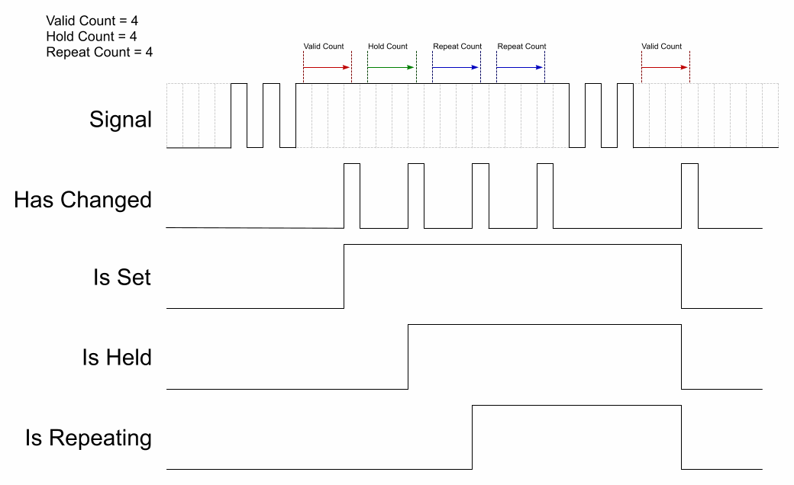


  Header: `debounce_multi.h`  
  Since: `20.50.0`  


`etl::debounce_multi` is a template class that debounces a whole field of bits read from a single IO port value (e.g., all the pins read in one `uint8_t`/`uint16_t`/etc.) in parallel, rather than debouncing a single bit like `etl::debounce`.

**Per-Bit State Machine**  
Each bit progresses through `debounce_state_id`: `Off` → `On` → `Held` → `Repeating`, tracked bitmask state registers plus a per-bit counter array, letting it debounce `Width` independent bits simultaneously with compact storage.

**Core Operations**  
-	**Construction/reset**: `debounce_multi(initial)` / `reset(initial)` initializes all bits to `Off` and sets the starting starting sample; `reset_bit(n, initial)` resets a single bit.
-	**Updating**:  
`update(next)` - processes an entire new raw port value in one call, updating all bits' states/counters and returning true if any bit changed.  
`update_incremental(next)` - processes one bit per call (useful for incrementally scanning a matrix one line at a time); returns `true` once all `Width` bits have been processed in the current cycle.
- **Querying**:  
  - `has_changed(n)`, `is_set(n)`, `is_held(n)`, `is_repeating(n)` - per-bit status.  
  - `get_state(n)` - returns the bit's `state_id` (`Off`/`On`/`Held`/`Repeating`).  
  - `get_changed()` - bitmask of all bits that changed on the last update.  
  - `get_active_mask()` - bitmask of all bits currently >= `On`.  
  - `get_width()` - returns `Width`.  
-	**Polarity**: Inputs must be supplied so that `0` represents the 'Off' state and `1` represents the 'On' state.
---

**Typical Use Case**  
This is generally useful anywhere you need debounced, simultaneous multi-bit digital input handling (e.g., reading a parallel GPIO port) without dynamic memory allocation, including support for "held"/"repeat" style key-repeat behavior.

```cpp
  template <typename TValue, size_t Width, uint32_t Valid_Count, uint32_t Hold_Count = 0, uint32_t Repeat_Count = 0>
  class debounce_multi
```

| Parameter     | Description                                                                                                            |
|---------------|------------------------------------------------------------------------------------------------------------------------|
|`TValue`       | The type of the port value. Must be an unsigned integral.                                                              |
|`Width`        | The number of bits in the field. `[1, sizeof(TValue) * CHAR_BIT)`                                                      |
|`Valid_Count`  | The number of consecutive samples a bit must differ from its previous debounced state before the state changes (>= 1). |
|`Hold_Count`   | The number of samples a bit must remain set (after becoming valid) before the 'held' state is reached. `0` = disabled. |
|`Repeat_Count` | Once 'held', a 'repeat' state is generated every `Repeat_Count` samples. `0` = disabled.                               |

## States

The debouncer can use one of four sets of state transitions, dependant on the values of `Valid_Count`, `Hold_Count`, `Repeat_Count`.  
Any state can transition directly to `Off`.
```cpp
Off -> Valid
Off -> Valid -> Held
Off -> Valid -> Repeating
Off -> Valid -> Held -> Repeating
```

The diagram below shows the effect of the various parameters.



## Static asserts

`TValue` must be a unsigned integral.  
`Width` must be greater than `0`.  
The size of `TValue` in bits must not be less than `Width`.  
`Valid_Count` must be greater than `0`. 

## Types

**External definition**
```cpp
struct debounce_state_id
```
```
Off       = 0  
On        = 1  
Held      = 2  
Repeating = 3  
```

---

**In class definitions**

| Type | Definitions |
|-----------------|------------------------------|
|`value_type`     | `TValue`                     |
|`state_id`       | `etl::debounce_state_id`     |
|`state_id::type` | The type to hold a `state_id`|

## Member functions

### Constructor
```cpp
debounce_multi_bit(value_type initial)
```
**Description**  
Constructor.  
All bits start in the `Off` state.

### reset(value_type)
```cpp
void reset(value_type initial)
```
**Description**  
Resets the debouncer state.  

**Parameters**  
`initial` : The default initial value is 'all inactive'. The value is the physical state of the input.  

### reset_state(size_t, bool)
```cpp
void reset_state(size_t n, bool initial)
```
**Description**  
The state is set to `Off` and the count is reset to `0`.  

**Parameters**  
`n` : The bit number `[0, Width)`. If `n` is out of range then it is ignored.  
`initial` : The default initial value is 'inactive'. The value is the physical state of the input.  

### update_incremental(value_type)
```cpp
bool update_incremental(value_type next)
```
**Description**  
Updates a *single* bit.  
The value of `next` must not change between calls to `update_incremental()` until all bits have been processed.  
Do not call `update()` after `update_incremental()` on the same instance unless `update_incremental()` has completed a full cycle (returned `true`).  
    
**Parameters**  
`next` The value of the whole multi bit field.  

**Return**  
`true` if all of the bits have been processed.

### update(value_type)
```cpp
bool update(value_type next)
```
**Description**  
Updates the whole port value.  

**Parameters**  
`next` The value of the whole multi bit field.  
Bits are strictly `1` = active, `0` = inactive.

**Return**  
`true` if any bit changed state.  

### has_changed(size_t)
```cpp
bool has_changed(size_t n) const
```
**Description**  
Checks if a bit's state has changed.  

**Parameters**  
`n` The bit number `[0, Width)`.  

**Return**  
Returns `true` if the bit changed state on the last update.  

### is_set(size_t)
```cpp
bool is_set(size_t n) const
```
**Description**  
Returns `true` if the bit is currently set.  

**Parameters**  
`n` : The bit number `[0, Width)`.

### is_held(size_t)
```cpp
bool is_held(size_t n) const
```
**Description**  
Returns `true` if the bit is currently held.  

**Parameters**  
 `n` :  The bit number [0, Width).

### is_repeating(size_t)
```cpp
bool is_repeating(size_t n) const
```
**Description**  
Returns `true` if the bit is currently repeating.  

**Parameters**  
 `n` :  The bit number [0, Width).

### get_width()
```cpp
ETL_CONSTEXPR size_t get_width() const
```
**Description**  
Returns the width of the bit field.

### get_active_mask()
```cpp
value_type get_active_mask() const
```
**Description**  
Returns a mask of all currently active bits (where state is `On`, `Held`, or `repeating`).  

### get_state(size_t)
```cpp
state_id::type get_state(size_t n) const
```
**Description**  
Returns the current state id of a bit.

**Return**  
One of:-  
`state_id::Off`  
`state_id::On`  
`state_id::Held`  
`state_id::Repeating`  

### get_changed()
```cpp
value_type get_changed() const
```
**Description**  
Returns the changed state of the bit field as a `value_type`.
