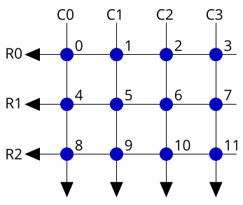


  Header: `key_matrix.h`  
  Since: `20.50.0`  


Debounces an R x C matrix of keys. Handles valid, held, and repeating key states. The key changes can be monitored by status functions and a built-in key event buffer. The number of buffered key events is selectable. For a key matrix without diodes ghost keys can be filtered out.  

---

The key values returned are assigned by column then row order.  


---

```cpp
  template <size_t N_Rows, size_t N_Columns, etl::bit_polarity::type Polarity, 
            uint32_t Valid_Count, uint32_t Hold_Count = 0, uint32_t Repeat_Count = 0, 
            size_t N_Key_Events = 1, bool Filter_Ghost_Keys = false>
  class key_matrix
```

| Parameter | Description |
|-|-|
|`TMatrix_Port`      | The type that interfaces with the key matrix hardware. Must implement `void select_column(column_index_type)` and `row_type read_row()`.|
|`NRows`             | The number of rows in the key matrix.                                                                                    |
|`NColumns`          | The number of columns in the key matrix.                                                                                 |
|`Valid_Count`       | The number of consecutive samples a bit must differ from its previous debounced state before the state changes (>= `1`). |
|`Hold_Count`        | The number of samples a bit must remain set (after becoming valid) before the 'held' state is reached. Default = `0`.    |
|`Repeat_Count`      | Once 'held', a 'repeat' state is generated every `Repeat_Count` samples. Default = `0`.                                  |
|`N_Key_Events`      | The maximum number of buffered key events. Default = `1`. Configure up to the number of physical keys.                   |
|`Filter_Ghost_Keys` | Set `true` for non-diode protected keys to remove ghost keys. Default = `false`                                          |

A value of `0` for `Hold_Count` or `Repeat_Count` will disable the corresponding functionality.  

## States

The keys can use one of four sets of state transitions, dependant on the values of `Valid_Count`, `Hold_Count`, `Repeat_Count`.  
Any state can transition directly to `Off`.

| States                             |
|------------------------------------|
|`Off -> Valid`                      |
|`Off -> Valid -> Held`              |
|`Off -> Valid -> Repeating`         |
|`Off -> Valid -> Held -> Repeating` |

## Static asserts

Uses the static asserts from `etl::debounce_multi`.

## key_matrix_state

```cpp
class key_state;
```
**Description**  
The state of a key in the matrix.  
It inherits from the `debounce_multi::state_id` to provide the same state IDs.  
External to the class `key_matrix`.

### Default constructor
```cpp
key_state()
```
**Description**  
Default constructor.  
Initialises the state to `key_matrix_state::Off`.

### Copy constructor
```cpp
key_state(const key_state& other)
```
**Description**  
Copy constructor.

### Construct from a `key_matrix_state::type`
```cpp
key_state(key_matrix_state::type state)
```
**Description**  
Construct from a key_matrix_state::type.

### Assignment operator from `key_matrix_state::type`
```cpp
key_matrix_state& operator=(key_matrix_state::type state_)
```
**Description**  
Assignment operator from `key_matrix_state::type`.

### is_pressed()
```cpp
bool is_pressed() const
```
**Description**  
Returns `true` if the key is currently pressed.

### is_held()
```cpp
bool is_held() const
```
**Description**  
Returns `true` if the key is currently held.

### is_repeating()
```cpp
bool is_repeating() const
```
**Description**  
Returns `true` if the key is currently repeating.

### value()
```cpp
key_state::type value() const
```
**Description**  
Returns the `key_matrix_state::type` value.

### operator==
```cpp
bool operator==(const key_matrix_state& lhs, const key_matrix_state& rhs)
```
**Description**  
Equality operator.  
Returns `true` if the `key_matrix_state`s are equal.

### operator!=
```cpp
bool operator!=(const key_matrix_state& lhs, const key_matrix_state& rhs)
```
**Description**  
Inequality operator.  
Returns `true` if the `key_matrix_state`s are not equal.

## key_matrix_traits

```cpp
template <size_t N_Rows, size_t N_Columns>
struct key_matrix_traits
```
**Description**  
Defines the traits dependent on `NRows` and `NColumns`.

| Type              | Description                                                       |
|-------------------|-------------------------------------------------------------------|
|`row_type`         | The type that holds the value read from the key matrix rows.      |
|`column_index_type`| The type that holds a column index that selects the active column.|
|`key_type`         | The type that holds a key value.                                  |
|`key_state`        | The type that holds the state of a key in the key matrix.         |
|`key_event`        | The key event that is generated when a key changes state.         |

---

```cpp
constexpr key_type Invalid_Key
```
**Description**  
The invalid key code.  
The range of supported keys is `[0, Invalid_Key)`.

### key_event
```cpp
struct key_event
```
**Description**  
A key event that is pushed into the key event buffer when a key changes state.  

| Type             | Description                                    |
|------------------|------------------------------------------------|
|`key_type  key;`  | The key code of the key that has changed state.|
|`key_state state;`| The new state of the key.                      |

### column_size()
```cpp
ETL_CONSTEXPR size_t column_size() const
```
**Description**  
Returns `NColumns`.

### row_size()
```cpp
ETL_CONSTEXPR size_t row_size() const
```
**Description**  
Returns `NRows`.  

### matrix_size()
```cpp
ETL_CONSTEXPR size_t matrix_size() const
```
**Description**  
Returns `N_Rows * N_Columns`.

### max_key_id()
```cpp
ETL_CONSTEXPR size_t max_key_id() const
```
**Description**  
Returns the maximum key ID that can be used with this key matrix.  
The range of supported keys is `[0, max_key_id()]`.

## key_matrix
```cpp
  template <typename TMatrix_Port, size_t N_Rows, size_t N_Columns, uint32_t Valid_Count, uint32_t Hold_Count = 0, uint32_t Repeat_Count = 0,
            size_t N_Key_Events = 1, bool Filter_Ghost_Keys = false>
  class key_matrix : public key_matrix_traits<N_Rows, N_Columns>
```
**Description**  
A key matrix decoder.  

| Template parameter | Description                                                                                                                          |
|--------------------|--------------------------------------------------------------------------------------------------------------------------------------|
|`TMatrix_Port`      | The type that provides the interface to the key matrix hardware.                                                                     |
|`N_Rows`            | The number of rows in the key matrix. Rows are read from the key matrix.                                                             |
|`N_Columns`         | The number of columns in the key matrix. Columns are written to the key matrix.                                                      |
|`Valid_Count`       | The number of consecutive samples a bit must differ from its previous debounced state before the state changes (>= 1).               |
|`Hold_Count`        | The number of samples a bit must remain set (after becoming valid) before a *held* event is generated. `0` = disabled. Default = `0`.|
|`Repeat_Count`      | Once held, a *repeat* event is generated every `Repeat_Count` samples. `0` = disabled. Default = `0`.                                |
|`N_Key_Events`      | The number of keys that may be buffered simultaneously. Default = `1`.                                                               |
|`Filter_Ghost_Keys` | If `true`, any newly changed bits that are ghosted are suppressed until the ambiguity resolves. Default = `false`.                   |

## Member types
    
| Type               |                                                               |
|--------------------|---------------------------------------------------------------|
|`row_type`          | The type that holds the value read from the key matrix column |
|`column_index_type` | The type that holds a column index                            |
|`key_type`          | The type that holds a key value                               |

## key_state

A nested type of `key_matrix`.  
Defined as `etl::key_matrix_state`.  

## key_event

A nested type of `key_matrix`. 
Defined in `etl::key_matrix_traits`.

## Member constants

| Constant           |                                                                        |
|--------------------|------------------------------------------------------------------------|
|`Invalid_Key`       | The invalid key code. The range of supported keys is `[0, Invalid_Key)`|

## Member functions
### Constructor
```cpp
key_matrix()
```
**Description**  
Constructor.

### reset()
```cpp
void reset()
```
**Description**  
Resets the key matrix.
Resets all states and state timers.
Selects column `0`.

### scan_incremental()
```cpp
bool scan_incremental()
```
**Description**  
Scans one column of the key matrix.  
This function must be called repeatedly to scan the whole key matrix.  
When the last column has been scanned then any key changes are pushed to the key event buffer.  

**Returns**
`true` if all of the columns have been processed, otherwise `false`.

### scan()
```cpp
void scan()
```
**Description**  
Scans the whole key matrix.  
This function will scan all of the columns and rows in the key matrix.

### get_key_state(size_t)
```cpp
key_state get_key_state(size_t key) const
```
**Description**  
Returns the current debounced state of the specified key.

### max_number_of_key_events()
```cpp
ETL_CONSTEXPR size_t max_number_of_key_events() const
```
**Description**  
Returns the maximum number of key events that can be buffered.

### number_of_key_events()
```cpp
size_t number_of_key_events() const
```
**Description**  
Returns the number of key events that have been buffered.

### has_key_events()
```cpp
bool has_key_events() const
```
**Description**  
Returns `true` if there are key events in the buffer.

### next_key_event()
```cpp
key_event next_key_event()
```
**Description**  
Returns the next key event from the buffer.  
If the buffer is empty then returns a `key_event` with key = `Invalid_Key` and state = `Off`.

### clear_key_events()
```cpp
void clear_key_events()
```
**Description**  
Clears the key event buffer.

### max_key_id()
```cpp
ETL_CONSTEXPR size_t max_key_id() const
```
**Description**  
Returns the maximum key ID that can be used with this key matrix.  
The range of supported keys is `[0, max_key_id()]`.

## Example

You have a 4 column x 3 row matrix of keys.  
The polarity for column outputs and row inputs is active-low.  
The maximum number of events to be buffered is 3.  
The key matrix supports *pressed* and *held* functionality, but not *repeating*.  
The matrix does not require anti-ghosting.  

```cpp
#include <stdio.h>

#include "etl/key_matrix.h"

const size_t   N_Rows                = 3;
const size_t   N_Columns             = 4;
const uint32_t Valid_Count           = 4;
const uint32_t Hold_Count            = 4;
const uint32_t Repeat_Count          = 0;
const size_t   N_Key_Events          = 3;
const bool     Filter_Ghost_Keys_Off = false;

uint8_t row;
uint8_t column;

// The matrix IO ports.
uint8_t* row_port    = &row;
uint8_t* column_port = &column;

//*************************************************************************
// A port that provides the interface to the key matrix hardware.
//*************************************************************************
struct MatrixPort
{
  using row_type          = etl::key_matrix_traits<N_Rows, N_Columns>::row_type;
  using column_index_type = etl::key_matrix_traits<N_Rows, N_Columns>::column_index_type;

  //***************************************************************************
  // Write the column index to the key matrix.
  // Active low so invert the value.
  //***************************************************************************
  void select_column(column_index_type column_index)
  {
    *column_port = static_cast<uint8_t>(~(1U << column_index));
  }

  //***************************************************************************
  // Read a value from the key matrix.
  // Active low, so invert the value.
  //***************************************************************************
  row_type read_row()
  {
    return static_cast<row_type>(~(*row_port));
  }
};

// The port to interface with the hardware.
MatrixPort matrixPort;

using KeyMatrix = etl::key_matrix<MatrixPort, N_Rows, N_Columns, Valid_Count, Hold_Count, Repeat_Count, N_Key_Events, Filter_Ghost_Keys_Off>;
using KeyEvent  = KeyMatrix::key_event;
using KeyType   = KeyMatrix::key_type;
using KeyState  = KeyMatrix::key_state;

// The keyboard matrix.
KeyMatrix keyMatrix(matrixPort);

//***************************************************************************
// Function to handle key events.
//***************************************************************************
void HandleKeyEvent(const KeyEvent& keyEvent)
{
  KeyType  key   = keyEvent.key;
  KeyState state = keyEvent.state;

  switch (state.value())
  {
    case KeyState::Off: printf("%d : Off\n", key); break;
    case KeyState::On: printf("%d : On\n", key); break;
    case KeyState::Held: printf("%d : Held\n", key); break;
    case KeyState::Repeating: printf("%d : Repeating\n", key); break;
    default: break;
  }
}

//***************************************************************************
// Called regularly, usually from a timer interrupt.
//***************************************************************************
void KeyScanTick()
{
  if (keyMatrix.scan_incremental())
  {
    while (keyMatrix.has_key_events())
    {
      HandleKeyEvent(keyMatrix.next_key_event());
    }
  }
}
```