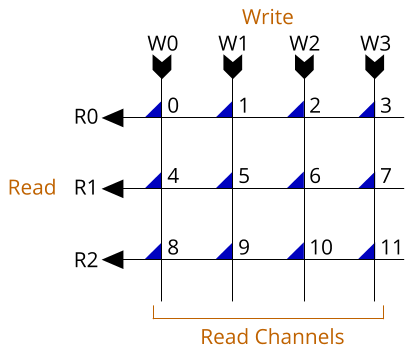


  Header: `key_matrix.h`  
  Since: `20.50.0`  


## Description

`etl::key_matrix` is a template class for scanning a read/write key matrix (e.g., a keyboard or keypad) with built-in debouncing and optional ghost-key filtering.

It is supplied with a port type that abstracts the hardware interface (reading from and writing to the matrix).

## Key features

- **Scanning**  
  Drives a port object to read from and write to the matrix.
  - `scan_incremental()` scans one write line per call and returns `true` once a full matrix pass completes.  
  - `scan()` scans the entire matrix in one call (loops over `scan_incremental()`) and returns `true`if any key has changed state.  

-	**Debouncing**  
Each key is independently debounced for press/hold/repeat/release.  

-	**Ghost-key filtering**  
When `Filter_Ghost_Keys` is enabled, the system detects and filters out "ghost" keys (false positives caused by multiple simultaneous key presses in a matrix), after each full scan cycle.  
This feature is unnecessary for diode-protected key matrices.

- **Key events**  
  Generates `key_event` objects (key id + key_state: Off/On/Hold/Repeat.) and stores them in an internal buffer.  
  Managed by the member functions:-
  - `has_key_events()`
  - `number_of_key_events()`
  - `next_key_event()`
  - `clear_key_events()`.  

-	**State queries**  
  `get_key_state(size_t key)` returns the debounced state of an individual key from its ID.  

-	**Reset**  
`reset()` clears all debounce states, the event buffer, and resets scanning to the first write line.  

-	**Polarity**  
Inputs must be supplied so that `0` represents the 'Off' state and `1` represents the 'On' state.  
Outputs are present so that `0` represents the 'Off' state and `1` represents the 'On' state.

## Key event generation

**Note**: Event generation timing changes when ghost-key filtering is enabled.  

### Ghost-key filtering disabled
Key state changes are validated and added to the event queue after each incremental scan.

### Ghost-key filtering enabled
Because ghost keys can only be identified and removed after scanning the entire matrix, the event queue is populated only after the final incremental scan completes.

## Key event queue

The key event queue is a simple single threaded type.  
It is expected to be read and cleared within the same thread or interrupt context as the key matrix scan.

## Typical Use Case
You implement a small port/adaptor class with `write_key_matrix()` and `read_key_matrix()` methods for your hardware, then repeatedly call `scan()` or `scan_incremental()` in a polling loop, and call `next_key_event()` to get the current set of debounced key events.

## Typical key matrix layout

The key values returned are assigned by `etl::key_matrix` by write-line, then read-line order.  


## Maximum key pad size

The size of the key pad is only limited by the maximum unsigned int type on your platform, which affects the types for `key_matrix::read_type`, `key_matrix::write_index_type`, and `key_matrix::key_type`.  

| Type             |                                                                            |
|------------------|----------------------------------------------------------------------------|
|`read_type`       | The value type read from the matrix.                                       |
|`write_index_type`| The value type used to write the *index* of the 'write line' on the matrix.|
|`key_type`        | The key ID value type.                                                     |

### Maximum size
Assume that `uint32_t` is the largest supported unsigned int.  

A `uint32_t` `read_type` allows 32 'read lines' to be read.  
A `uint32_t` `write_index_type` allows one of 4,294,967,296 'write lines' to be selected.  

As `key_type` is also affected by this limit the key id will also be limited, to the range [0, 4,294,967,295]

The maximum supported number of keys in this case is just over 4 billion.

### A more realistic example

Assume that the number of read lines is 8, and the number of write lines is 32.  

`read_type` will be defined as `uint8_t`.  
`write_index_type` will be defined as `uint8_t`.  
`key_type` will be defined as `uint8_t`.  

The maximum supported number of keys in this case is 256 [0, 255].

### Matrix layout affects types

Assume that the number of read lines is 16, and the number of write lines is 16.  

`read_type` will be defined as `uint16_t`.  
`write_index_type` will be defined as `uint8_t`.  
`key_type` will be defined as `uint8_t`.  

The maximum supported number of keys in this case is also 256 [0, 255].

## States

The keys can use one of four sets of state transitions, dependant on the values of `Valid_Count`, `Hold_Count`, `Repeat_Count`.  
Any state can transition directly to `Off`.

| States                             |
|------------------------------------|
|`Off -> Valid`                      |
|`Off -> Valid -> Held`              |
|`Off -> Valid -> Repeating`         |
|`Off -> Valid -> Held -> Repeating` |

## Static asserts

`etl::key_matrix` translates debounce states into key event states.
For efficiency, it uses a lookup table to do this.
If the debounce states have been modified and are no longer compatible, then it will static assert.

| Other static asserts |                                                         |
|----------------------|---------------------------------------------------------|
|`N_Read > 0`          | The number of read lines must be greater than 0.        | 
|`N_Write > 0`         | The number of write lines must be greater than 0.       |  
|`Valid_Count > 0`     | The valid count must be greater than 0.                 |
|`N_Key_Events > 0`    | The number of queued key events must be greater than 0. |

## key_matrix_traits

```cpp
template <size_t N_Read, size_t N_Write>
struct key_matrix_traits
```
**Description**  
Defines the traits dependent on `N_Read` and `N_Write`.

### Types

| Type              | Description                                                          |
|-------------------|----------------------------------------------------------------------|
|`read_type`        | The type that holds the value read from the key matrix.              |
|`write_index_type` | The type that holds a write index that selects the active write line.|
|`key_type`         | The type that holds a key value.                                     |
|`key_state`        | The type that holds the state of a key in the key matrix.            |
|`key_event`        | The key event that is generated when a key changes state.            |

### Max_Key

```cpp
static ETL_CONSTANT key_type Max_Key
```
**Description**  
The maximum valid key code.  
Equals `(N_Read * N_Write) - 1`.
The range of supported keys is `[0, Max_Key]`.

### write_size()
```cpp
ETL_CONSTEXPR size_t write_size() const
```
**Description**  
Returns `N_Write`.

### read_size()
```cpp
ETL_CONSTEXPR size_t read_size() const
```
**Description**  
Returns `N_Read`.  

### matrix_size()
```cpp
ETL_CONSTEXPR size_t matrix_size() const
```
**Description**  
Returns `N_Read * N_Write`.

### max_key()
```cpp
ETL_CONSTEXPR size_t max_key() const
```
**Description**  
Returns the maximum key ID that can be used with this key matrix (`Max_Key`).  
The range of supported keys is `[0, max_key()]`.

## key_state

The state of a key in the key matrix.  
A nested class of `etl::key_matrix_traits`.

```cpp
class key_state;
```

### States
```
Invalid
Off
Pressed
Held
Repeating
```

### Default constructor
```cpp
key_state()
```
**Description**  
Default constructor.  
Initialises the state to `key_matrix_state::Off`.

### Copy constructor
```cpp
key_state(const key_state& other)
```
**Description**  
Copy constructor.

### Construct from a `key_matrix_state::type`
```cpp
key_state(key_matrix_state::type state)
```
**Description**  
Construct from a key_matrix_state::type.

### Assignment operator from `key_matrix_state::type`
```cpp
key_matrix_state& operator=(key_matrix_state::type state_)
```
**Description**  
Assignment operator from `key_matrix_state::type`.

### is_pressed()
```cpp
bool is_pressed() const
```
**Description**  
Returns `true` if the key is currently pressed.

### is_held()
```cpp
bool is_held() const
```
**Description**  
Returns `true` if the key is currently held.

### is_repeating()
```cpp
bool is_repeating() const
```
**Description**  
Returns `true` if the key is currently repeating.

### is_invalid()
```cpp
bool is_invalid() const
```
**Description**  
Returns `true` if the key state is invalid.

### value()
```cpp
key_state::type value() const
```
**Description**  
Returns the `key_matrix_state::type` value.

### operator==
```cpp
bool operator==(const key_matrix_state& lhs, const key_matrix_state& rhs)
```
**Description**  
Equality operator.  
Returns `true` if the `key_matrix_state`s are equal.

### operator!=
```cpp
bool operator!=(const key_matrix_state& lhs, const key_matrix_state& rhs)
```
**Description**  
Inequality operator.  
Returns `true` if the `key_matrix_state`s are not equal.

## key_event

A key event that is pushed into the key event buffer when a key changes state.  
A nested class of `etl::key_matrix_traits`.

```cpp
struct key_event
```

| Type             | Description                                    |
|------------------|------------------------------------------------|
|`key_type  key;`  | The key code of the key that has changed state.|
|`key_state state;`| The new state of the key.                      |

## key_matrix
```cpp
template <typename TMatrix_Port, size_t N_Read, size_t N_Write = 1, 
          uint32_t Valid_Count = 1, uint32_t Hold_Count = 0, 
          uint32_t Repeat_Count = 0, size_t N_Key_Events = 1,
          bool Filter_Ghost_Keys = false>
class key_matrix
```
**Description**  
A key matrix decoder.  
Inherits the implementation of `etl::key_matrix_traits`.

---

| Parameter | Description |
|--------------------|---------------------------------------------------------------------------------------------------------------------------------------------------|
|`TMatrix_Port`      | The type that interfaces with the key matrix hardware. Must implement `void write_key_matrix(write_index_type)` and `read_type read_key_matrix()`.|
|`N_Read`            | The number of read lines in the key matrix.                                                                                                       |
|`N_Write`           | The number of write lines in the key matrix.                                                                                                      |
|`Valid_Count`       | The number of consecutive samples a bit must differ from its previous debounced state before the state changes (>= `1`). Default = 1.             |
|`Hold_Count`        | The number of samples a bit must remain set (after becoming valid) before the 'held' state is reached. Default = `0`.                             |
|`Repeat_Count`      | Once 'held', a 'repeat' state is generated every `Repeat_Count` samples. Default = `0`.                                                           |
|`N_Key_Events`      | The maximum number of buffered key events (>= `1`). Default = `1`. Configure up to the number of physical keys.                                            |
|`Filter_Ghost_Keys` | Set `true` for non-diode protected keys to remove ghost keys. Default = `false`                                                                   |

A value of `0` for `Hold_Count` or `Repeat_Count` will disable the corresponding functionality.  

## Member types
    
| Type              |                                                               |
|-------------------|---------------------------------------------------------------|
|`read_type`        | The type that holds the value read from the key matrix        |
|`write_index_type` | The type that holds a write index                             |
|`key_type`         | The type that holds a key value                               |

### key_state

A nested type of `key_matrix`.  
Defined in `etl::key_matrix_traits`.  
[Go to definition](#key_state)

### key_event

A nested type of `key_matrix`.  
Defined in `etl::key_matrix_traits`.  
[Go to definition](#key_event)

## Member constants

### Max_Key
Defined in `etl::key_matrix_traits`.  
[Go to definition](#max_key)

## Member functions
### Constructor
```cpp
key_matrix()
```
**Description**  
Constructor.  
Calls `reset()`.  

### reset()
```cpp
void reset()
```
**Description**  
Resets the key matrix.  
Resets states and state timers and the key event buffer.  
Selects write line `0`.  

### scan_incremental()
```cpp
bool scan_incremental()
```
**Description**  
Scans one write line of the key matrix.  
This function must be called repeatedly to scan the whole key matrix.  
When the last write line has been scanned then any key changes are pushed to the key event buffer.  

**Returns**  
`true` if all of the write lines have been processed, otherwise `false`.

### scan()
```cpp
bool scan()
```
**Description**  
Scans the whole key matrix.  
This function will scan all of the write lines and read lines in the key matrix.

**Returns**  
`true` if any key events have been produced, otherwise `false`.  

### get_key_state(size_t)
```cpp
key_state get_key_state(size_t key) const
```
**Description**  
Returns the current debounced state of the specified key.

### max_number_of_key_events()
```cpp
ETL_CONSTEXPR size_t max_number_of_key_events() const
```
**Description**  
Returns the maximum number of key events that can be buffered.

### number_of_key_events()
```cpp
size_t number_of_key_events() const
```
**Description**  
Returns the number of key events that have been buffered.

### has_key_events()
```cpp
bool has_key_events() const
```
**Description**  
Returns `true` if there are key events in the buffer.

### next_key_event()
```cpp
key_event next_key_event()
```
**Description**  
Returns the next key event from the buffer.  
If the buffer is empty then returns a `key_event` with key = `0` and state = `Invalid`.

### clear_key_events()
```cpp
void clear_key_events()
```
**Description**  
Clears the key event buffer.

## Example

You have a 4 write x 3 read matrix of keys.  
The polarity for write outputs and read inputs is active-low.  
The maximum number of events to be buffered is 3.  
The key matrix supports *pressed* and *held* functionality, but not *repeating*.  
The matrix does not require anti-ghosting.  

```cpp
#include <stdio.h>

#include "etl/key_matrix.h"

const size_t   N_Read                = 3;
const size_t   N_Write               = 4;
const uint32_t Valid_Count           = 4;
const uint32_t Hold_Count            = 4;
const uint32_t Repeat_Count          = 0;
const size_t   N_Key_Events          = 3;
const bool     Filter_Ghost_Keys_Off = false;

//*************************************************************************
// A port that provides the interface to the key matrix hardware.
//*************************************************************************
struct MatrixPort
{
  using read_type        = etl::key_matrix_traits<N_Read, N_Write>::read_type;
  using write_index_type = etl::key_matrix_traits<N_Read, N_Write>::write_index_type;

  MatrixPort()
  : read_port((uint8_t*)0x100000)
  , write_port((uint8_t*)0x100001)
  {
  }

  //***************************************************************************
  // Write the write index to the key matrix.
  // Active low so invert the value.
  //***************************************************************************
  void write_key_matrix(write_index_type write_index)
  {
    *write_port = static_cast<uint8_t>(~(1U << write_index));
  }

  //***************************************************************************
  // Read a value from the key matrix.
  // Active low, so invert the value.
  //***************************************************************************
  read_type read_key_matrix()
  {
    return static_cast<read_type>(~(*read_port));
  }

  // The matrix IO ports.
  uint8_t* read_port;
  uint8_t* write_port;
};

// The port to interface with the hardware.
MatrixPort matrixPort;

using KeyMatrix = etl::key_matrix<MatrixPort, N_Read, N_Write, Valid_Count, Hold_Count, Repeat_Count, N_Key_Events, Filter_Ghost_Keys_Off>;
using KeyEvent  = KeyMatrix::key_event;
using KeyType   = KeyMatrix::key_type;
using KeyState  = KeyMatrix::key_state;

// The keyboard matrix.
KeyMatrix keyMatrix(matrixPort);

//***************************************************************************
// Function to handle key events.
//***************************************************************************
void HandleKeyEvent(const KeyEvent& keyEvent)
{
  KeyType  key   = keyEvent.key;
  KeyState state = keyEvent.state;

  switch (state.value())
  {
    case KeyState::Off: printf("%d : Off\n", key); break;
    case KeyState::On: printf("%d : On\n", key); break;
    case KeyState::Held: printf("%d : Held\n", key); break;
    case KeyState::Repeating: printf("%d : Repeating\n", key); break;
    default: break;
  }
}

//***************************************************************************
// Called regularly, usually from a timer interrupt.
//***************************************************************************
void KeyScanTick()
{
  if (keyMatrix.scan_incremental())
  {
    while (keyMatrix.has_key_events())
    {
      HandleKeyEvent(keyMatrix.next_key_event());
    }
  }
}
```