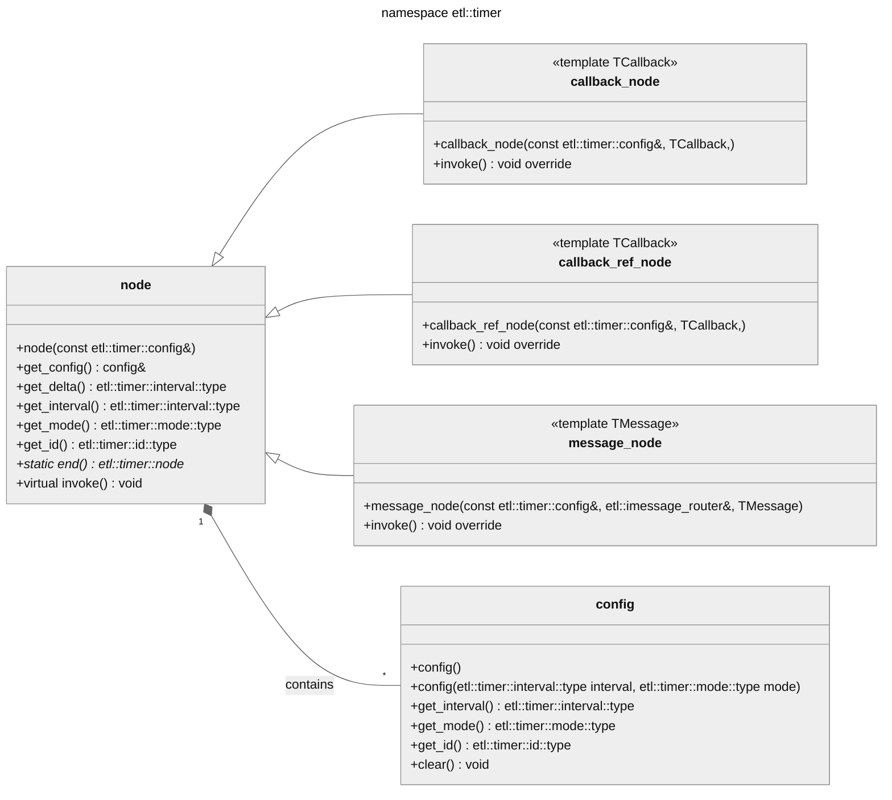


  Header: `timer_node.h`  
  Namespace: `etl::timer`  
  Since: `20.50.0`  
  From: `C++03`
 

## Class diagram


## node
```cpp
class node
```
**Description**  
Base class for all timer nodes.  
Used as the timer element in `etl::intrusive_timer`.  

Derive from this to create custom callback timer nodes.

---

```cpp
node(const etl::timer::config& config_) ETL_NOEXCEPT
```
**Description**  
Construct from an `etl::timer::config`.    

---

```cpp
node(const etl::timer::node& node_) ETL_NOEXCEPT
```
**Description**  
Copy constructor.

---

```cpp
const etl::timer::config& get_config() const ETL_NOEXCEPT
```
**Description**  
Returns the configuration of the timer.

---

```cpp
ETL_CONSTEXPR etl::timer::interval::type get_delta() const ETL_NOEXCEPT
```
**Description**  
Returns the delta of the timer.

---

```cpp
ETL_CONSTEXPR etl::timer::interval::type get_interval() const ETL_NOEXCEPT
```
**Description**  
Returns the interval of the timer.

---

```cpp
ETL_CONSTEXPR etl::timer::mode::type get_mode() const ETL_NOEXCEPT
```
**Description**  
Returns the mode of the timer.  
One of:-  
`etl::timer::mode::No_Mode`  
`etl::timer::mode::Single_Shot`  
`etl::timer::mode::Repeating`  

---

```cpp
ETL_CONSTEXPR etl::timer::id::type get_id() const ETL_NOEXCEPT
```
**Description**  
Returns the id of the timer.

---

```cpp
static etl::timer::node* end() ETL_NOEXCEPT
```
**Description**  
Returns a pointer to the static sentinel timer node used to mark the end of the intrusive timer lists.

## callback_node
```cpp
template <typename TCallback>
class callback_node : public etl::timer::node
```
**Description**  
A timer node for a function callback using `etl::delegate`, `etl::inplace_function`, functors or lambdas that can be copied.  
Derived from `etl::timer::node`.  

## callback_ref_node
```cpp
template <typename TCallback>
class callback_node : public etl::timer::node
```
**Description**  
A timer node for a function callback using functors that cannot be copied.  
Derived from `etl::timer::node`. 

## message_node
```cpp
template <typename TMessage>
class message_node : public etl::timer::node
```
**Description**  
A timer node for a message callback using an `etl::message` derived object.  
Derived from `etl::timer::node`.  
Static asserts if `TMessage` is not derived from `etl::imessage`.

## Examples

### Global function callback

This example shows a node configured for a global function callback.  

```cpp
void callback()
{
  std::cout << "callback()\n";
}

etl::timer::config config(etl::timer::config(100, etl::timer::mode::Single_Shot));
etl::timer::callback_node node(config, callback);
```

### Lambda callback

This example shows a node configured for a lambda function callback.  

```cpp
auto callback = [](){ std::cout << "lambda\n"; };

etl::timer::config config(etl::timer::config(100, etl::timer::mode::Single_Shot));
etl::timer::callback_node node(config, callback);
```

### Message callback

This example shows a node configured for a message callback.  

```cpp
struct CallbackMessage : public etl::message<1>
{
};

class MessageProcessor : public etl::message_router<MessageProcessor, CallbackMessage>
{
public:

  MessageProcessor()
    : etl::message_router<MessageProcessor, CallbackMessage>()
  {
  }

  //*******************************************
  void on_receive(const CallbackMessage& msg)
  {
    std::cout << "CallbackMessage\n";
  }

  //*******************************************
  void on_receive_unknown(const etl::imessage& msg) {}
};

MessageProcessor message_processor;
CallbackMessage message

etl::timer::config config(etl::timer::config(100, etl::timer::mode::Single_Shot));
etl::timer::message_node node(config, message_processor, message);
```

### Functor callback

This example shows a node configured for a functor function callback.  
The node makes a copy of the functor.  

```cpp
int call_count = 0;

// Functor that can be copied to the node, because `call_count` is referenced by a pointer.
struct Functor
{
  Functor(int& call_count_)
    : call_count(&call_count_)
  {
  }

  void operator()()
  {
    ++(*call_count);
    std::cout << "Functor ref callback : " << *call_count << "\n";
  }

  int* call_count;
};

Functor functor;

etl::timer::config config(etl::timer::config(100, etl::timer::mode::Single_Shot));
etl::timer::callback_node node(config, functor);
```

### Functor ref callback

This example shows a node configured for a functor function callback.  
The node takes a reference to the functor.  

```cpp
// Functor that must not be copied to the node, otherwise `functor` will not get updated.
struct Functor
{
  Functor()
    : call_count(0)
  {
  }

  void operator()()
  {
    ++call_count;
    std::cout << "Functor ref callback : " << call_count << "\n";
  }

  int call_count;
};

Functor functor;

etl::timer::config config(etl::timer::config(100, etl::timer::mode::Single_Shot));
etl::timer::callback_ref_node node(config, functor);
```

### Delegate callback

This example shows a node configured for an `etl::delegate` callback.  

```cpp
struct Object
{
  Object()
    : call_count(0)
  {
  }

  void Increment()
  {
    ++call_count;
    std::cout << "Increment callback : " << call_count << "\n";
  }

  int call_count;
};

static Object object;

auto delegate = etl::delegate<void()>::create<Object, &Object::Increment, object>();

etl::timer::config config(etl::timer::config(100, etl::timer::mode::Single_Shot));
etl::timer::callback_node node(config, delegate);
```
