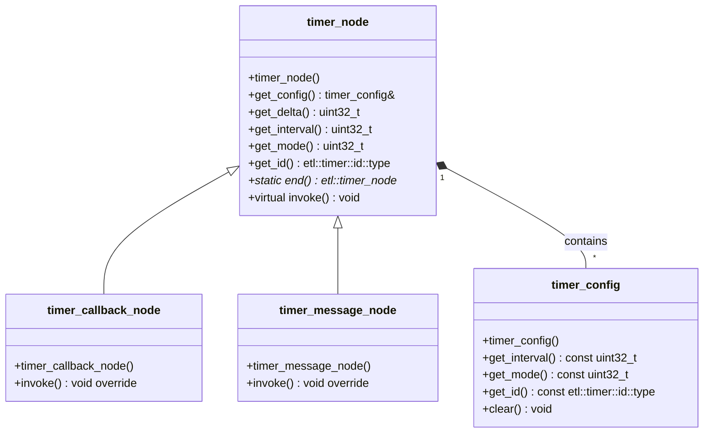


  Header: `timer_node.h`  
  Since: `20.46.0`  
  From: `C++03`



## Class diagram


---

These are supporting class types for `etl::intrusive_timer`.

## timer_config
```cpp
class timer_config
```
**Description**  
Contains the configuration for a timer.  

---

```cpp
ETL_CONSTEXPR timer_config(uint32_t interval, etl::timer::mode::type mode) ETL_NOEXCEPT
```
**Description**  
Constructs a timer configuration.  

**Parameters**  
`uint32_t interval` : The initial interval for the timer.
`etl::timer::mode::type mode` : The initial mode of the timer.

---

```cpp
ETL_CONSTEXPR uint32_t get_interval() const ETL_NOEXCEPT
```
**Description**  
Returns the interval of the timer.

---

```cpp
ETL_CONSTEXPR etl::timer::mode::type get_mode() const ETL_NOEXCEPT
```
**Description**  
Returns the mode of the timer.  
`etl::timer::mode::No_Mode_Set`  
`etl::timer::mode::Single_Shot`  
`etl::timer::mode::Repeating`  

---

```cpp
ETL_CONSTEXPR etl::timer::id::type get_id() const ETL_NOEXCEPT
```
**Description**  
Returns the id of the timer.  
The timer ID is set by registering a node that contains this configuration with an `etl::intrusive_timer`.

---

```cpp
ETL_CONSTEXPR14 void clear() ETL_NOEXCEPT
```
**Description**  
Clears the timer configuration.  
Interval = `etl::timer::interval::No_Active_Interval`  
Mode     = `etl::timer::mode::No_Mode_Set`  
ID       = `etl::timer::id::No_Timer`  

## timer_node
```cpp
class timer_node
```
**Description**  
Base class for all timer nodes.

---

```cpp
timer_node(const timer_config& config_) ETL_NOEXCEPT
```
**Description**  
Construct from an `etl::timer_config`.    

---

```cpp
timer_node(const timer_node& node_) ETL_NOEXCEPT
```
**Description**  
Copy constructor.

---

```cpp
const timer_config& get_config() const ETL_NOEXCEPT
```
**Description**  
Returns the configuration of the timer.

---

```cpp
ETL_CONSTEXPR uint32_t get_delta() const ETL_NOEXCEPT
```
**Description**  
Returns the delta of the timer.

---

```cpp
ETL_CONSTEXPR uint32_t get_interval() const ETL_NOEXCEPT
```
**Description**  
Returns the interval of the timer.

---

```cpp
ETL_CONSTEXPR etl::timer::mode::type get_mode() const ETL_NOEXCEPT
```
**Description**  
Returns the mode of the timer.  
`etl::timer::mode::No_Mode_Set`  
`etl::timer::mode::Single_Shot`  
`etl::timer::mode::Repeating`  

---

```cpp
ETL_CONSTEXPR etl::timer::id::type get_id() const ETL_NOEXCEPT
```
**Description**  
Returns the id of the timer.

---

```cpp
static etl::timer_node* end() ETL_NOEXCEPT
```
**Description**  
Returns a pointer to the static sentinel timer node used to mark the end of the intrusive timer lists.

## timer_callback_node
```cpp
template <typename TCallback>
class timer_callback_node : public etl::timer_node
```
**Description**  
A timer node for a function callback using `etl::delegate`, `etl::inplace_function`, or similar.  
Derived from `etl::timer_node`.  

## timer_message_node
```cpp
template <typename TMessage>
class timer_message_node : public etl::timer_node
```
**Description**  
A timer node for a message callback using an `etl::message` derived object.  
Derived from `etl::timer_node`.  
Static asserts if `TMessage` is not derived from `etl::imessage`.
